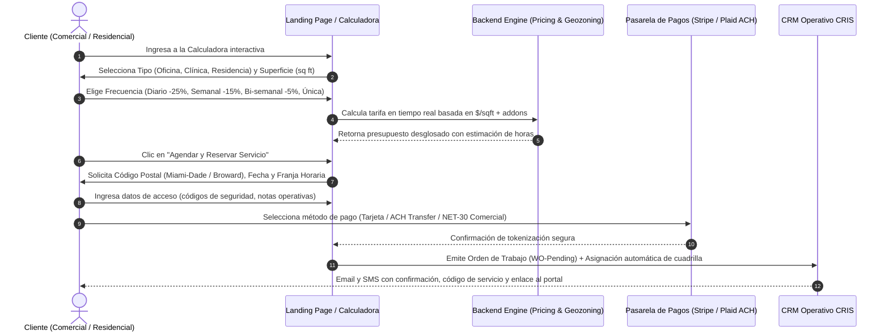
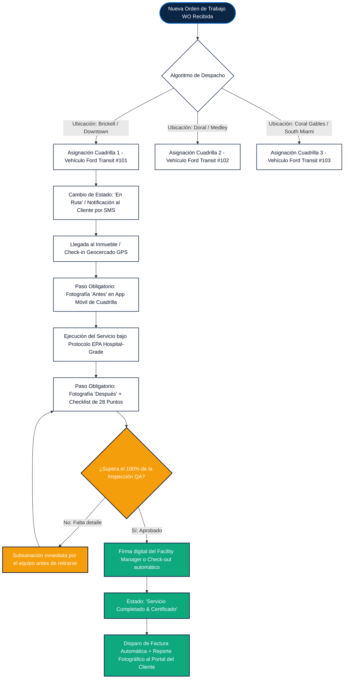

# Diagrama de Arquitectura de Información y Flujo de Navegación
## CRIS Quality Solution LLC (Chris Quality Service) — Miami, FL

Este documento define la arquitectura de navegación, los flujos de interacción del usuario (UX) y el ciclo de operaciones del CRM administrativo para la validación con la Gerencia antes del inicio de la construcción del frontend.

---

## 1. Mapa de Navegación Global (Sitemap)

```mermaid
graph TD
    classDef main fill:#0B2032,stroke:#1E857B,stroke-width:2px,color:#FFFFFF;
    classDef client fill:#1E857B,stroke:#249C90,stroke-width:2px,color:#FFFFFF;
    classDef crm fill:#071624,stroke:#C0392B,stroke-width:2px,color:#FFFFFF;
    classDef calc fill:#16344E,stroke:#38BDF8,stroke-width:2px,color:#FFFFFF;

    Home[Landing Page Principal / Index]:::main
    
    %% Ramas Públicas
    Home --> Services[Servicios Comerciales & Residenciales]:::main
    Home --> About[Sobre Nosotros & Certificaciones EPA/OSHA]:::main
    Home --> Calculator[Calculadora Interactiva de Presupuestos]:::calc
    Home --> Contact[Contacto Directo & Línea Miami 305]:::main
    Home --> ClientLogin[Acceso a Clientes / Client Portal]:::client
    Home --> AdminLogin[Acceso Corporativo / CRM Admin]:::crm

    %% Flujo de Conversión
    Calculator --> Checkout[Proceso de Reserva & Checkout Seguro]:::calc
    Checkout --> Confirmation[Confirmación de Orden & Onboarding]:::calc

    %% Portal de Clientes
    ClientLogin --> ClientDashboard[Dashboard de Cliente]:::client
    ClientDashboard --> InspectionLog[Inspección Fotográfica Antes/Después]:::client
    ClientDashboard --> ScheduledVisits[Calendario de Visitas & Cuadrilla]:::client
    ClientDashboard --> BillingHistory[Historial de Facturación & Pagos ACH]:::client
    ClientDashboard --> AddonService[Solicitud de Servicios Especiales]:::client

    %% CRM Administrativo
    AdminLogin --> CRMDashboard[Panel de Control Operativo]:::crm
    CRMDashboard --> DispatchBoard[Despacho & Rutas Miami-Dade/Broward]:::crm
    CRMDashboard --> WorkOrders[Gestión de Órdenes de Trabajo / Kanban]:::crm
    CRMDashboard --> QAAudit[Auditoría de Calidad & Checklists EPA]:::crm
    CRMDashboard --> InvoicingCRM[Facturación Automatizada & Cobros]:::crm
    CRMDashboard --> CrewManagement[Gestión de Personal & Certificaciones]:::crm
```



---

## 2. Flujo de Conversión del Cliente (Embudo de Ventas: Cotización $\to$ Reserva)

El embudo garantiza que un cliente residencial o corporativo obtenga un presupuesto transparente en menos de 90 segundos y pueda agendar sin fricciones.



---

## 3. Flujo Operativo del CRM y Despacho en Campo (Operations & Field Execution)

Refleja la promesa de valor: control riguroso, trazabilidad GPS y auditoría fotográfica antes/después garantizada.



---

## 4. Arquitectura de Pantallas del CRM Administrativo

```mermaid
graph LR
    classDef admin fill:#0B2545,stroke:#00B4D8,stroke-width:2px,color:#fff;
    classDef view fill:#F8FAFC,stroke:#0066CC,stroke-width:1.5px,color:#0F172A;

    CRMRoot[Panel Central / Dashboard]:::admin

    CRMRoot --> V1[1. Monitor de Rendimiento / KPIs]:::view
    V1 --- D1[• Ingresos Recurrentes Mensuales MRR<br>• Tasa de Cumplimiento de Horarios 99.4%<br>• Puntuación de Satisfacción CSAT 4.9/5.0<br>• Horas Facturadas vs Estimadas]

    CRMRoot --> V2[2. Dispatch Board Interactivo]:::view
    V2 --- D2[• Mapa de calor Miami-Dade & Broward<br>• Rastreo GPS en tiempo real de vehículos<br>• Estado de cuadrillas: En ruta, Limpiando, Libre<br>• Alertas de tráfico en I-95 y Palmetto]

    CRMRoot --> V3[3. Tablero Kanban de Servicios]:::view
    V3 --- D3[• Programados (Scheduled)<br>• En Camino (In Route)<br>• En Proceso (In Progress)<br>• Inspección QA Aprobada<br>• Facturados & Pagados]

    CRMRoot --> V4[4. Repositorio de Auditoría Fotográfica]:::view
    V4 --- D4[• Búsqueda por Cliente y Fecha<br>• Comparador visual 'Antes / Después'<br>• Certificados de desinfección descargables PDF]
```

---

## 5. Portal de Clientes (Client Self-Service Experience)

Diseñado para administradores de condominios de lujo, oficinas corporativas y propietarios que exigen control absoluto:

1. **Dashboard Principal:**
   - Próxima visita programada con foto y nombre del líder de cuadrilla.
   - Estado en tiempo real del servicio en curso (ej. *"Cuadrilla en sitio limpiando piso 4"*).
2. **Inspecciones Fotográficas:**
   - Galería interactiva con deslizador (*slider*) comparativo de alta definición.
   - Registro de sellos temporales y firmas de auditoría de supervisores.
3. **Gestión de Facturación y Finanzas:**
   - Descarga de facturas fiscales con desglose de servicios.
   - Configuración de pagos automatizados ACH (Plaid) o tarjetas corporativas con recibos automáticos.
4. **Solicitudes en Un Clic:**
   - Adición de servicios extraordinarios (lavado profundo de alfombras, pulido de mármol, desinfección con nebulizador EPA).
